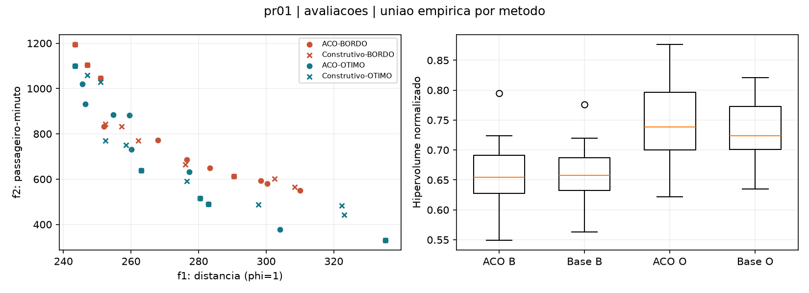
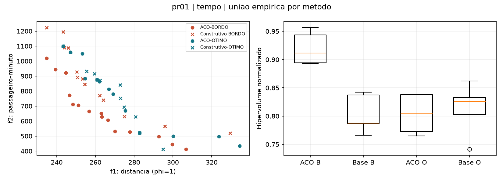

# Resultados executados da ACO própria

## Escopo efetivamente executado

- **Piloto:** 120 execuções; cinco sementes, seis casos e quatro tratamentos.
- **Campanha por avaliações:** 720 execuções; sementes 0 a 29 em seis casos e quatro tratamentos. Parada em 100 iterações ou 200 mil consultas.
- **Comparação adicional por tempo:** 20 execuções de pr01; sementes 0 a 4, quatro tratamentos e 60 segundos de busca por execução. Não é uma campanha temporal de 30 sementes em todas as instâncias.
- **Verificações:** 26 testes unittest aprovados, regressões publicadas preservadas, gabaritos por enumeração/MIP e auditoria independente dos JSONs reabertos.

Os tratamentos são ACO-BORDO, construtivo-BORDO, ACO-OTIMO e construtivo-OTIMO. O construtivo conserva atratividade, roleta e pesos, mas mantém feromônios em 1. O piloto usou quatro processos; as campanhas de avaliações e tempo usaram oito. Não comparar diretamente os tempos do piloto com os das campanhas.

## Referências pequenas

| Recorte | Pedidos | Pontos com OTIMO | Menor recuperação observada, ACO-OTIMO |
|---|---|---:|---:|
| pr01-volta | 1,2,3,4,5 | 4 | 75,0% |
| pr01-ida | 13,14,15,16,17 | 15 | 100,0% |
| pr01-misto | 1,2,13,14,15 | 8 | 100,0% |

A enumeração e o MIP corrigido coincidem com tolerância 1e-3 nos três recortes. Todas as agendas MIP foram auditadas independentemente. No recorte de volta, ACO-OTIMO recuperou três dos quatro pontos nas sementes 10 e 17 (HV relativo 0,9932 e 0,9895); ACO-BORDO recuperou oito dos dez pontos na semente 19. O piloto de cinco sementes não mostrou essas perdas. Isso reforça a necessidade das repetições e não viola a correção das soluções. A cobertura de igualdade continua sendo estrita: frentes iguais têm C(A,A)=0, enquanto recuperação/HV relativo reconhecem a coincidência.

## Qualidade na campanha por avaliações

Hipervolume mediano, com normalização comum por caso. A escala abaixo usa a união dos dados da campanha e da comparação temporal; em pr01, pode diferir da escala do CSV isolado de cada pasta. Maior é melhor. Não comparar valores absolutos de casos diferentes.

| Caso | ACO-BORDO | Construtivo-BORDO | ACO-OTIMO | Construtivo-OTIMO |
|---|---:|---:|---:|---:|
| a2-16 | 0,5226 | 0,5144 | 1,0500 | 1,0278 |
| b2-16 | 0,6688 | 0,6453 | 1,1347 | 1,1002 |
| pr01 | 0,6547 | 0,6579 | 0,7388 | 0,7236 |
| pr01-ida | 0,8431 | 0,8431 | 0,9706 | 0,9706 |
| pr01-misto | 0,8638 | 0,8638 | 0,9640 | 0,9640 |
| pr01-volta | 1,1339 | 1,1339 | 1,1961 | 1,1961 |

## Custo e comparação adicional por tempo em pr01

| Regime | Método | Horários | Sementes | HV mediano | Tempo mediano (s) |
|---|---|---|---:|---:|---:|
| avaliacoes | aco | bordo | 30 | 0,6547 | 4,82 |
| avaliacoes | aco | otimo | 30 | 0,7388 | 35,06 |
| avaliacoes | construtivo | bordo | 30 | 0,6579 | 4,90 |
| avaliacoes | construtivo | otimo | 30 | 0,7236 | 35,52 |
| tempo | aco | bordo | 5 | 0,9113 | 60,00 |
| tempo | aco | otimo | 5 | 0,8042 | 60,00 |
| tempo | construtivo | bordo | 5 | 0,7876 | 60,00 |
| tempo | construtivo | otimo | 5 | 0,8257 | 60,00 |

O limite de tempo é cooperativo, conferido antes de cada consulta: a consulta em andamento e a conclusão da construção podem produzir pequeno excedente. Exportação, métricas, gabaritos e reagendamento cruzado são medidos fora da busca.

Em pr01, a mediana favorece ACO-OTIMO no orçamento por avaliações (0,7388 contra
0,6547 de ACO-BORDO). Com sessenta segundos por execução, a mediana favorece
ACO-BORDO (0,9113 contra 0,8042). O custo de resolver horários por PL muda o
compromisso entre avaliações realizadas e qualidade. A segunda comparação usa
cinco sementes e não demonstra superioridade geral de um agendador.

## Auditoria dos artefatos reabertos

| Etapa | Execuções | Construções completas | Soluções distintas por execução | Pontos de fronteira | Falhas |
|---|---:|---:|---:|---:|---:|
| piloto | 120 | 128261 | 45909 | 1073 | 0 |
| campanha | 720 | 769223 | 274171 | 6229 | 0 |
| tempo_pr01 | 20 | 5556 | 5556 | 169 | 0 |

O contador de soluções distintas acima é somado por execução; a mesma solução encontrada em sementes diferentes aparece mais de uma vez. Agendas, objetivos, pareamento, capacidade, janelas, duração, políticas efetivas e orçamento foram conferidos nos JSONs, sem depender dos CSVs consolidados.

## O que estes resultados permitem concluir

A implementação manual produz soluções válidas, é reproduzível no regime por avaliações e recupera referências pequenas. O ganho de OTIMO pode ser maior que o ganho do reforço por feromônios; BORDO e OTIMO também podem aceitar conjuntos diferentes de rotas. Os CSVs de reagendamento usam a mesma união bruta de sequências para isolar esse efeito.

Comparar ACO com o construtivo dentro do mesmo caso, política e regime. As medianas não são prova de superioridade universal: não se realizou teste de significância, ajuste extensivo ou avaliação de carros/vans nesta etapa. O experimento temporal é complementar e limitado a pr01 com cinco sementes. Nas instâncias completas, a referência é empírica; não há certificado de ótimo global.

## Arquivos para conferir e reproduzir

- [Descrição, pseudocódigo e comandos](ACO.md).
- [Métricas com escala conjunta](../resultados/aco/comparacao/metricas.csv).
- [Medianas e quartis](../resultados/aco/comparacao/resumo.csv).
- [Cobertura estrita nos dois sentidos](../resultados/aco/comparacao/cobertura.csv).
- [Piloto](../resultados/aco/piloto/manifesto.json), [campanha](../resultados/aco/campanha/manifesto.json) e [comparação temporal](../resultados/aco/tempo_pr01/manifesto.json).
- `resultados/aco/*/execucoes/`: JSONs brutos com todas as construções completas, inclusive dominadas, e índice de ocorrências.
- `resultados/aco/campanha/fontes/` e `tempo_pr01/fontes/`: cópias das fontes usadas; versões, hashes, argumentos e sementes nos manifestos.
- `reavaliacao.csv` e `*_reavaliacao.json` em cada pasta: agendas comparadas sobre a mesma união bruta, custo e PLs fora da busca.

