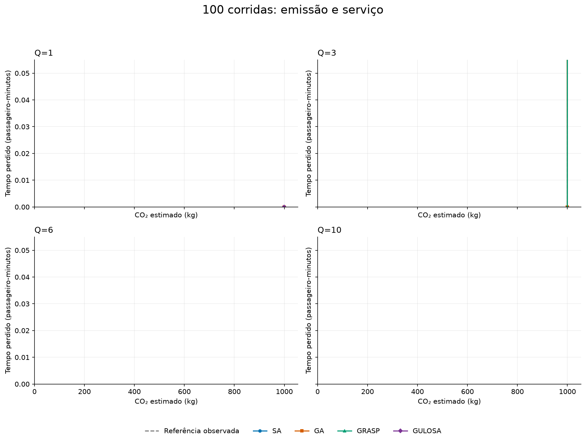
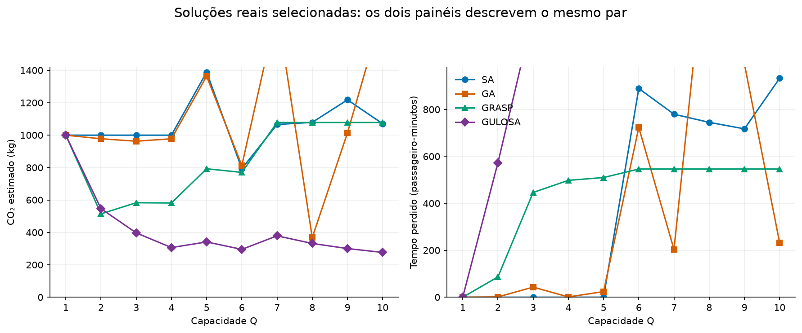
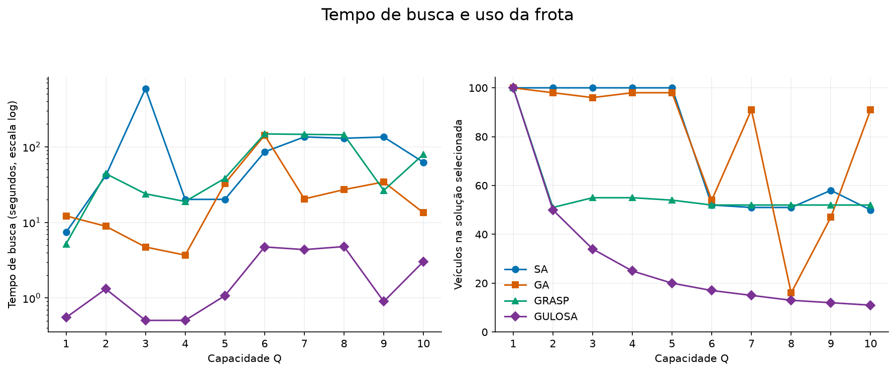

# Gráficos do experimento

Uma execução por método/Q, sem faixa estatística. Fatores sintéticos; referência empírica, sem prova de ótimo.

## 1. Fronteiras

Cada ponto é uma solução completa. Menor emissão e menor tempo perdido são preferíveis. Linhas apenas conectam alternativas discretas. Escalas comuns entre painéis.

## 2. Compromissos pareados

Os valores dos dois painéis pertencem à mesma solução de cada método/Q, selecionada pelo critério de equilíbrio documentado em RESUMO.md. Não são mínimos independentes.

## 3. Tempo e frota

Tempo da busca, sem conferência posterior, com eixo logarítmico. Veículos usados pela mesma solução do gráfico 2. Métodos têm esforços diferentes; tempo isolado não prova eficiência.

[Resumo](RESUMO.md) · [Soluções completas](solucoes.csv)
