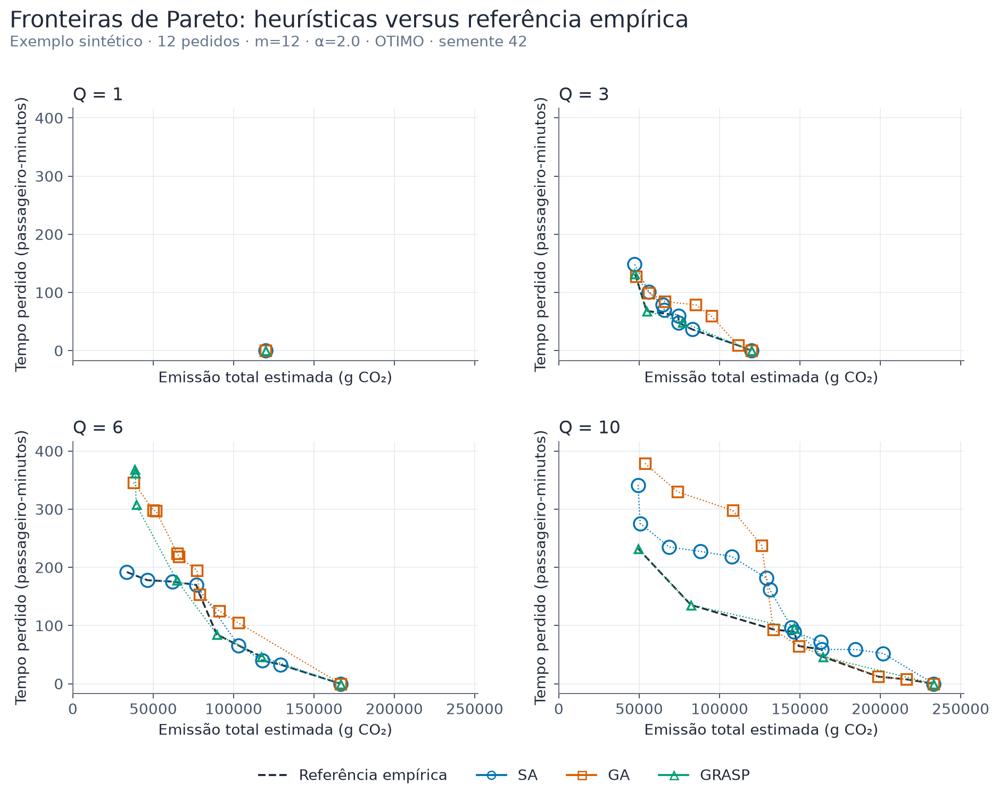
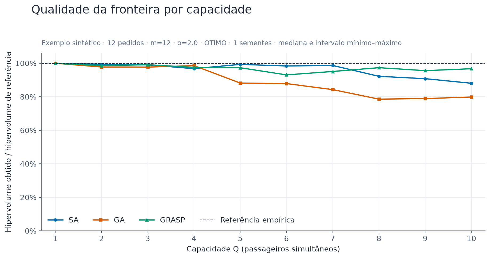
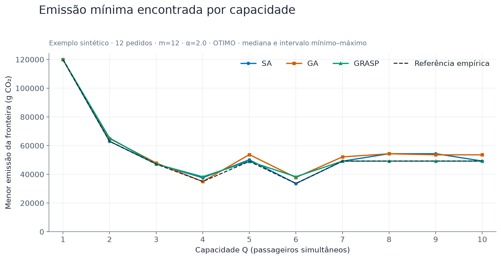
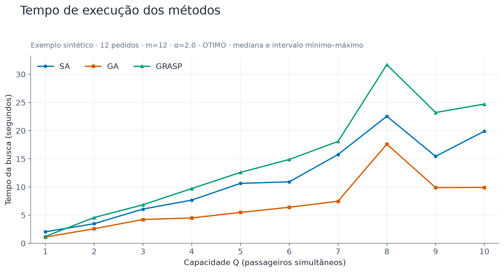
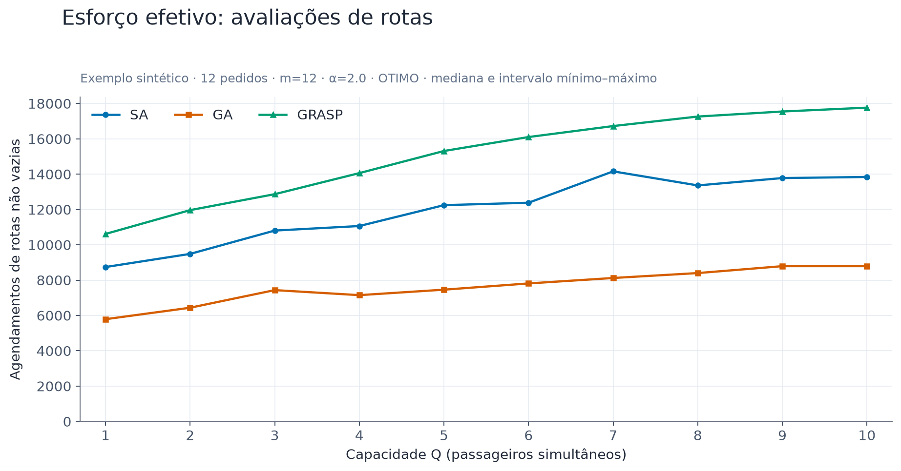
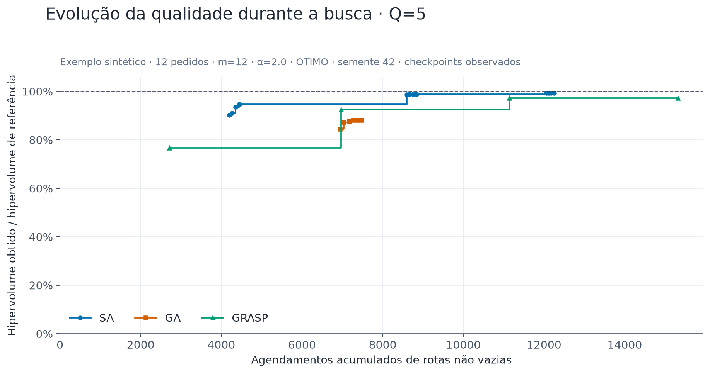
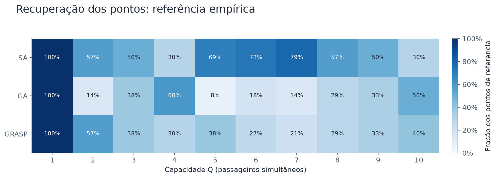
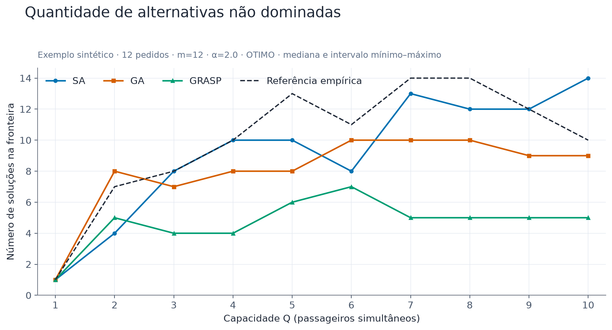
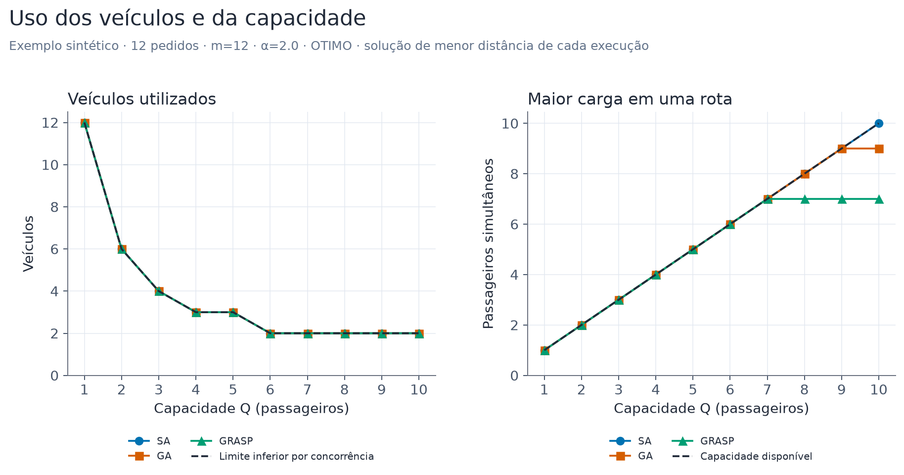
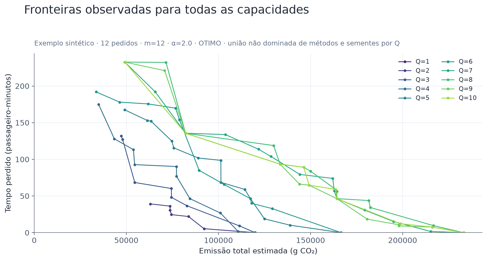

# Guia dos gráficos: emissão estimada e tempo perdido

Exemplo sintético · 12 pedidos · m=12 · α=2.0 · OTIMO

30 execuções; 1 semente(s) por método/Q. Referência: união não dominada dos métodos e sementes, para o mesmo Q.

f1 é CO2 operacional estimado, em gramas: phi(Q) × soma das distâncias ponderadas pelas ruas. Fatores são sintéticos, não calibrados. A distância física permanece separada no JSON. Os perfis, fatores sorteados e caminhos físicos estão em [ambiente_emissoes.json](ambiente_emissoes.json).

Aumentar Q altera também phi: o ótimo de emissão não é necessariamente monotônico. Escolhas de veículos e capacidade variam juntas neste protocolo; não isola o efeito de Q. Uma semente não estima variabilidade: quando há uma, a faixa mínimo–máximo tem largura zero.

[Soluções reais e critério de escolha](RESUMO_SOLUCOES.md) · [Resumo por execução](metricas.csv)

Tempo perdido é espera após a coleta desejada mais excesso a bordo, em passageiro-minutos. Não é a duração total da viagem. O hipervolume relativo mede cobertura da referência, não erro percentual da emissão. As linhas das fronteiras conectam soluções discretas; interpolar não cria uma solução viável.

## Fronteiras por método e capacidade

Mais à esquerda e abaixo é melhor. Cada símbolo é uma solução viável; os painéis usam a mesma escala.

Uma semente por método. Símbolos sobrepostos indicam soluções coincidentes; linhas só guiam a leitura, não representam soluções contínuas.

[PNG](graficos/01_fronteiras_metodos.png) · [SVG](graficos/01_fronteiras_metodos.svg)

## Qualidade por Q

100% significa o mesmo hipervolume da referência: união não dominada dos métodos e sementes, para o mesmo Q. Valores menores revelam alternativas ainda não recuperadas.

Mesma normalização para todas as capacidades e sementes; a faixa é mínimo–máximo, não intervalo de confiança.

[PNG](graficos/02_qualidade_por_q.png) · [SVG](graficos/02_qualidade_por_q.svg)

## Benefício e saturação da capacidade

Menor emissão encontrada em cada execução. Pode subir ao mudar a categoria do veículo. Não representa simultaneamente o melhor serviço.

O extremo de distância não representa simultaneamente o melhor serviço; consulte a fronteira completa.

[PNG](graficos/03_distancia_por_q.png) · [SVG](graficos/03_distancia_por_q.svg)

## Custo computacional observado

Compara o tempo efetivamente gasto nesta máquina, incluindo construção e busca, sem incluir validação posterior ou enumeração exata.

Os métodos têm parâmetros e esforços diferentes. Menor tempo isoladamente não certifica maior eficiência.

[PNG](graficos/04_tempo_execucao.png) · [SVG](graficos/04_tempo_execucao.svg)

## Esforço medido

Conta também as avaliações na construção e no cruzamento, omitidas pelos antigos contadores dos métodos.

Conta chamadas de agendamento de rota, não soluções completas, iterações ou necessariamente resoluções bem-sucedidas de PL.

[PNG](graficos/05_esforco_computacional.png) · [SVG](graficos/05_esforco_computacional.svg)

## Convergência observada

A curva registra a qualidade do arquivo Pareto ao longo do esforço acumulado. Subidas indicam novas alternativas úteis.

Cada método registra checkpoints próprios. Não há interpolação nem observação a cada movimento; só uma semente é mostrada.

[PNG](graficos/06_evolucao_busca.png) · [SVG](graficos/06_evolucao_busca.svg)

## Recuperação de pontos de referência

Cada célula mostra a média da fração de pontos de referência recuperados nas sementes; coincidência usa tolerância 1e-6 nos objetivos.

Essa medida verifica pontos coincidentes, enquanto hipervolume também reconhece aproximações úteis.

[PNG](graficos/07_recuperacao_pontos.png) · [SVG](graficos/07_recuperacao_pontos.svg)

## Número de alternativas

Mostra quantas escolhas de compromisso cada execução encontrou, usando os mesmos critérios de dominância.

Mais pontos não implica maior qualidade: uma fronteira com muitos pontos pode ser dominada por outra menor.

[PNG](graficos/08_cardinalidade.png) · [SVG](graficos/08_cardinalidade.svg)

## Uso dos veículos e da capacidade

Mostra o agrupamento efetivamente encontrado: quantidade de veículos e maior ocupação na solução de menor emissão estimada de cada execução.

Mediana e mínimo–máximo entre sementes. Carga máxima é um pico, não ocupação média. O limite de veículos vale porque todas as coletas antecedem qualquer entrega neste cenário.

[PNG](graficos/09_uso_capacidade.png) · [SVG](graficos/09_uso_capacidade.svg)

## Efeito de Q na fronteira inteira

Cada cor representa a união não dominada observada para um Q. Compare emissão estimada em níveis semelhantes de tempo perdido, ou vice-versa.

Referências empíricas: buscas incompletas e phi diferente entre categorias influenciam as curvas. Não há prova de otimalidade.

[PNG](graficos/10_fronteiras_todos_q.png) · [SVG](graficos/10_fronteiras_todos_q.svg)

